<!-- Layout adapted from ruchira-edirisinghe's profile README. -->

<!-- The artwork in assets/ is drawn by .github/scripts/draw_assets.py; the stats, streak, languages and snake are
     redrawn every hour by .github/workflows/profile-assets.yml (stat_cards.py, frame_snake.py) into the output branch.
     Spacing: every block is its own 
 (GitHub gives a bare  line no margin but a paragraph 16px), with no
       spacers, and every image leaves the same clear space (theme.PAD) under itself, so the gaps all match.
     Width: every block is 88% wide (the link tiles 22% each) so it spans exactly the dividers' dotted line
     (theme.NARROW); the dividers themselves stay at 100%. -->


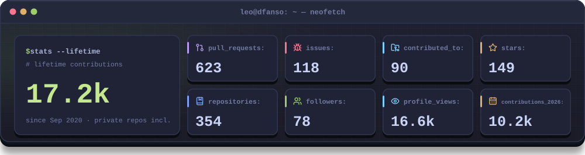

<a href="https://itsme.dfanso.dev"></a><a href="https://www.linkedin.com/in/leogavin/"></a><a href="https://www.instagram.com/dfansoo/"></a><a href="mailto:leogavin123@outlook.com"></a>


<a href="https://github.com/DFanso/key-vault-for-llm"></a><a href="https://github.com/iddhi-sulakshana/telegram-mcp">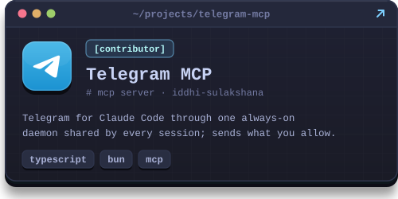</a>

<a href="https://github.com/DFanso/server-dash"></a><a href="https://github.com/DFanso/bridge-relay"></a>




<a href="https://itsme.dfanso.dev"></a>

<!-- invisible counter that records profile views; the stats above read its total -->

